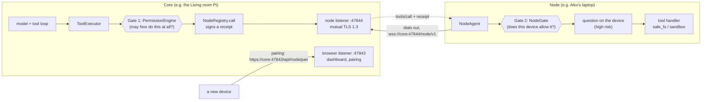
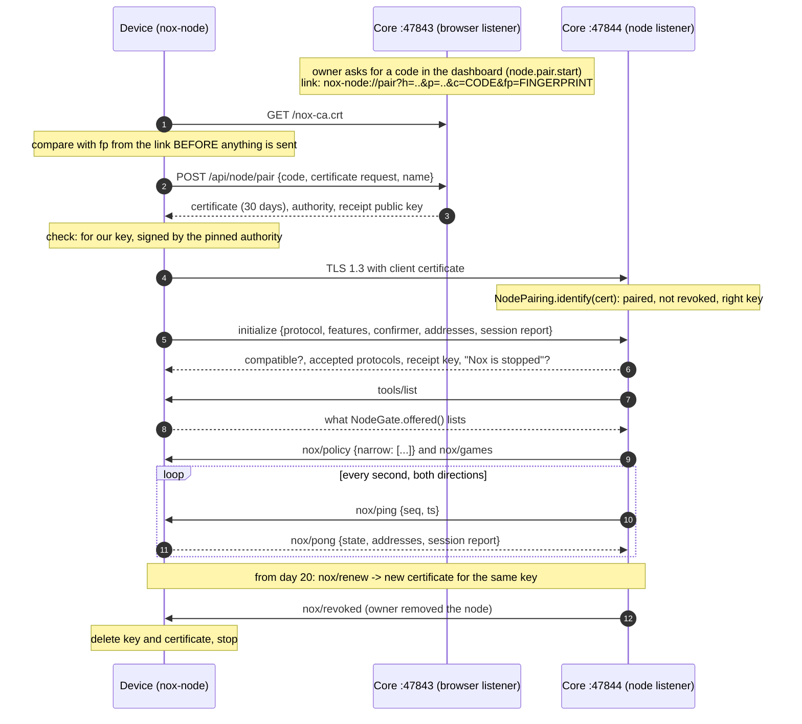
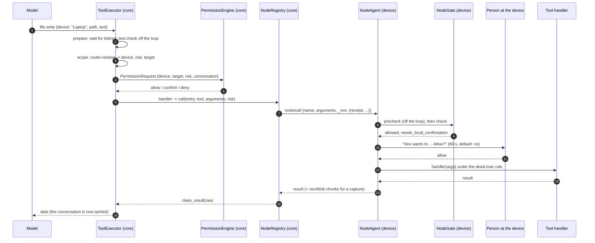
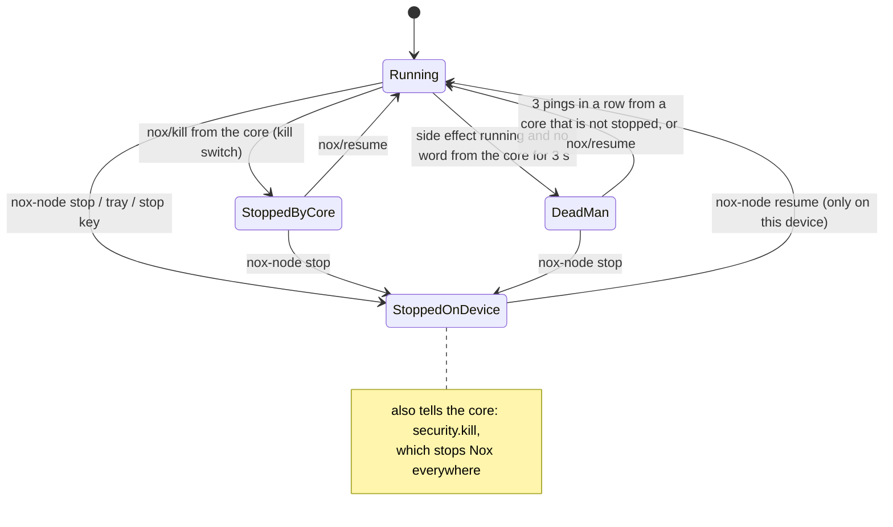
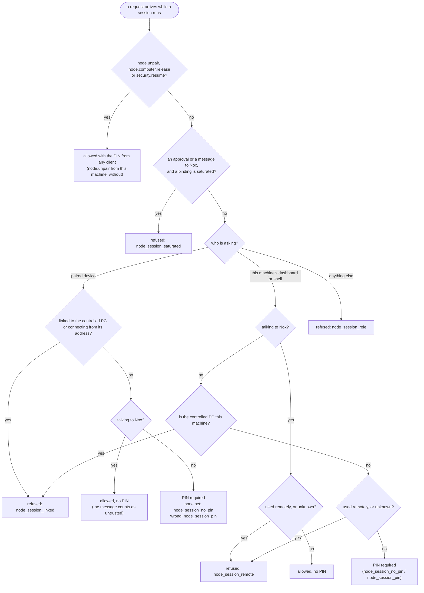
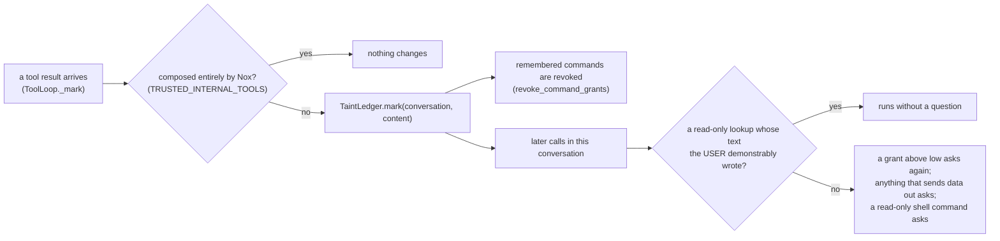
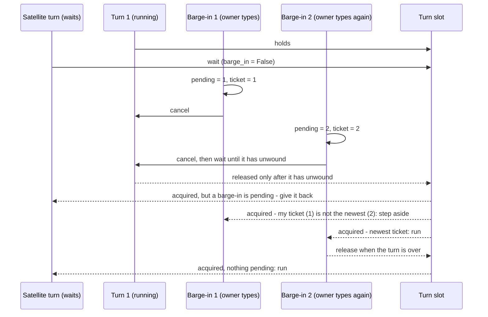
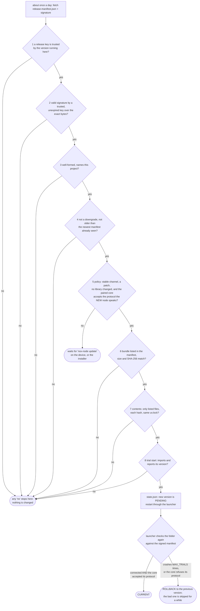

# Nodes: a map through the code

Audience: someone who wants to read, review or change the node code (`src/nox/node/`) and needs
to know where things are and why they are built this way. What a node is for and how to set one
up is in [`NODES.md`](NODES.md); the threat model and the residual risks are in
[`SECURITY.md`](SECURITY.md). This document is the map between the two: one picture of the
system, one call followed from the model to a file on another PC, and the seven places that are
hard to understand from a single module.

Every statement names the file and the function it comes from. No line numbers: they rot. If a
statement here and the code disagree, the code is right and this document has a bug.

Contents: [1 mental model](#1-the-mental-model) · [2 module map](#2-module-map) ·
[3 lifecycle](#3-lifecycle-of-a-node) · [4 one call](#4-one-call-end-to-end) ·
[5 stopping](#5-stopping) · [6 hard parts](#6-the-hard-parts) ·
[7 trust boundaries](#7-trust-boundaries) · [8 adding a tool](#8-adding-a-node-tool) ·
[9 tests](#9-tests) · [10 glossary](#10-glossary)

## 1. The mental model

A household has one **core** (the Nox that thinks: model, memory, permissions) and any number
of **nodes** (Nox's hands on the other computers). A node is a small program, `nox-node`, that
runs as the logged-in user of that computer.



Four things to keep in mind; everything else follows from them.

1. **The node dials the core, never the other way round** (`nox.node.device.agent.NodeAgent.run`).
   A node opens no port. The core cannot reach a node that is switched off, asleep or behind
   another network; it can only answer on a connection the node opened.
2. **Two ports on the core.** `47843` is the browser listener (dashboard for paired devices,
   and the one HTTPS endpoint a device pairs through). `47844` is the node listener
   (`nox.node.hub.listener`): only TLS 1.3 with a client certificate of this installation's own
   authority gets as far as a first message. They are separate so that the dashboard's browser
   hardening stays untouched and a firewall rule for "nodes" stays readable.
3. **Once connected, the roles flip.** The core is an MCP *client* of the node: it asks
   `tools/list` and sends `tools/call`. What a node may send on its own is a short allow-list
   (`nox.node.wire.protocol.NODE_TO_CORE`) - it cannot chat, read memory or answer a permission
   prompt, because no such method exists on this channel.
4. **Two gates, and the second does not trust the first.** The core's `PermissionEngine`
   decides whether Nox may do something at all (profile, privacy, grants, taint, a question to
   the user). The node's `NodeGate` decides again, on the device, by the device's own rules -
   and for high risk the person *at that device* is asked. A fully compromised core can sign
   whatever it wants; it still cannot switch on a capability the device did not enable, exceed
   the device's budget, or skip the device's question.

## 2. Module map

All paths are under `src/nox/`. "Owns" is what the module is the only place for; "does not" is
the thing a reader most often expects there and will not find.

The node code is three packages, by where it runs:

| Package | Runs on | What is in it |
| --- | --- | --- |
| `node/hub/` | the core | Everything that turns a model's tool call into a call on a device: the listener, pairing, the registry, routing, the dashboard's policy, the node-session rules. It may use the core (`core/`, `ipc/`, `lan/`, `remote/`, `data/`). |
| `node/device/` | the device (`nox-node`) | The agent, the gate, the hands, the satellites, the CLI, self-update. It must not use the core's runtime: a device has no database, no orchestrator and no permission engine. |
| `node/wire/` | both | What the two sides must agree on: the protocol and its bounds, receipts, the manifest vocabulary, names, the argument models of tools both sides validate, and the few pure rules both apply to the same text (speech, path spellings). |

The rules are a contract that CI checks (`lint-imports`, configured in `pyproject.toml`):

1. `wire` imports neither `device` nor `hub`.
2. `device` and `hub` never import each other - not directly and not through a chain of modules.
   What both need lives in `wire`.
3. `device` does not import the core runtime directly (`app`, `core.orchestrator`,
   `core.toolloop`, `core.boot`, `core.statemgr`, `ipc.dispatch`, `ipc.handlers`, `remote`,
   `data`, `memory`, `lan.app`, `lan.install`, `desktop.install`, `tools.executor`, `mcp.client`, `ai`, `noxos`).
   The shared libraries a device does use (`security`, `sandbox`, `hands`, `desktop`, `voice`,
   `release`, `lan.tls`, `ipc.tokens`, the logger and the config models) are not part of it.

Two imports are still allowed against rule 2, each with its reason next to it in
`pyproject.toml` (`ignore_imports`): `hub.install` reads the file tools' argument models and
refusal words from `device.hands` (they depend on the write rules inside `device.safe_fs`), and
`device.voice` builds the voice pipeline with the helpers in `nox.worker.main`, which reach the
core application only through its `voice setup` command. The list may only get shorter.

### Core side (`node/hub/`)

| Module | Owns | Does not |
| --- | --- | --- |
| `node/hub/install.py` | Wiring into a started core (`install`): the IPC requests, the routed tool specs, the stop hooks, and the node-session condition added to the access policy (`wire_guards`). | Decide anything itself. |
| `node/hub/listener.py` | The node port: TLS, "is this a paired node" (`NodePairing.identify`), the first message, the `NODE_TO_CORE` allow-list, pings, blobs, `broadcast_kill`. | Know what a tool is. |
| `node/hub/pairing.py` | One-time code -> client certificate, `identify`, renewal on the core, `revoke`. | Store anything secret of the node (it keeps hashes). |
| `node/hub/repo.py` | The node tables (certificates, groups, links). | The pairing row (that is `nox.remote.repo`). |
| `node/hub/registry.py` | Which nodes are online, what each offers (filtered: `ROUTABLE`, never a hard-prohibited name), the one call path `NodeRegistry.call`, cleaning results (`clean_result`). | Choose the device. |
| `node/hub/router.py` | Choosing the device (`resolve`) and the routed tool spec (`routed_spec`): scope, permission target, handler. | Talk to a node (it calls the registry). |
| `node/hub/policy.py` | What the dashboard may change: narrow a group, set a default device. | Widen anything. |
| `node/hub/world_routes.py` | The routed specs for captures, browser, desktop, computer use and media; `NodeControl` (the computer-use lock, address binding). | Run anything on a device. |
| `node/hub/session_access.py` | `NodeSessionCondition`: who may approve or change something while a session runs ([6c](#6c-approvals-during-a-node-session)), the three ways out (`ESCAPES`), the remote-session check. | The words of a refusal and the PIN checks (`security/access.py`), the lock itself (`NodeControl`). |
| `security/access.py` | `AccessPolicy`: the one place that decides, for a request (`decide`) and for an answer to a permission prompt (`approval`), whether a UI client may go ahead while synthetic input or a node session is in play. `ClientContext`, the verdicts (`Allow`, `Refuse`, `NeedsPin`), the refusal words (`REFUSE_*`), the calm-request rule (`calm_call`), `InputLock`, `PinChecks`. | Know a node, a role name or a transport. |
| `node/hub/satellites.py` | The core's side of voice on a node, OBS on a node and the overlay credential (`SatelliteHub`). | Audio. Only text arrives. |
| `node/hub/console.py` | "Is the console this core runs on a remote session" (`console_is_remote`), the one of the node-session checks that asks the operating system. | Decide what a remote session may do (`session_access`). |

### Device side (`node/device/`)

| Module | Owns | Does not |
| --- | --- | --- |
| `node/device/cli.py`, `node/device/cli_text.py` | `nox-node pair / run / allow / deny / stop / ...`: the only way to widen what the device allows. | Accept anything from the core. |
| `node/device/enroll.py` | Pairing from the device: pin the authority from the link, then send the code and a certificate request. | — |
| `node/device/home.py`, `node/device/keystore.py` | The node folder and the private key (never leaves the device). | — |
| `node/device/confirmed.py` | Which part of `node.yaml` a person really confirmed (HMAC in the node's audit trail). | Trust the file alone. |
| `node/device/agent.py` | The connection (`run`, backoff), the dispatch of what the core sends (`_dispatch`), one call (`_call`), the question on the device (`_confirm_here`), stop states, the dead-man rule, renewal. | Decide whether a call is allowed (that is the gate). |
| `node/device/gate.py` | `NodeGate`: every check before a handler runs, in a fixed order (`CHECK_ORDER`), budget, audit of every decision. | Open files or ask anyone. |
| `node/device/confirm.py` | The dialog itself on Windows, macOS, Linux; "is there a screen". | Decide when to ask. |
| `node/device/tools.py`, `node/device/hands.py`, `node/device/world.py` | The tools: `system.info` (reading in `wire/sysinfo.py`), `notify.show`; `file.*`, `shell.run`; captures, browser, desktop, computer use, media. | Check permissions (the gate did). They hold their *own* boundary: `safe_fs`, the sandbox, the game lock. |
| `node/device/safe_fs.py` | Opening a path so that the verdict is taken on the open handle; what a write may contain. | — |
| `node/device/voice.py`, `node/device/obs.py`, `node/device/overlay.py`, `node/device/satellite_node.py`, `node/device/satellite_cli.py`, `node/device/satellite_settings.py` | The satellites on the device: microphone and speaker, the device's own OBS, the overlay relay on loopback, their settings and commands. | Send audio to the core. |
| `node/device/update.py`, `node/device/bundle.py`, `node/device/renewal.py` | Self-update from a signed release; certificate renewal. | Take an update from the core. |
| `node/device/tray.py`, `node/device/appid.py` | Tray icon and stop key; the notification identity. | — |

### Shared wire code (`node/wire/`)

| Module | Owns |
| --- | --- |
| `node/wire/protocol.py` | Every message and its bounds, the two allow-lists (`NODE_TO_CORE`, `CORE_TO_NODE`), the protocol version range, the pairing link, the time a person at a device gets to answer (`CONFIRM_TIMEOUT_S`). |
| `node/wire/receipts.py` | Both ends of a receipt: `ReceiptSigner` (the core signs what it decided) and `ReceiptVerifier` (the device checks the signature, expiry, replay). |
| `node/wire/manifest.py` | `node.yaml` and the capability groups (`GROUPS`) - the words the device, the core and the dashboard share. |
| `node/wire/names.py` | Which device names are allowed (a name is typed on the device: untrusted text). |
| `node/wire/arguments.py` | The strict argument models of the tools both sides validate (`NoArgs`, `NotifyArgs`, `SayArgs`, `MediaArgs`, `ObsArgs`). The file tools' arguments stay in `device/hands.py` with their refusal rules. |
| `node/wire/speech.py` | What may be said on a node's speaker (`latin_only`, `speakable`, `say_refusal`): the core filters a sentence with it and the device filters it again. |
| `node/wire/paths.py` | Path spellings the device never resolves for the core (`names_a_path_alias`, `is_remote_or_device_path`): decided on the text alone. |
| `node/wire/addresses.py` | This machine's own addresses (`all_local_addresses`) and the value that means "unreadable" (`ADDRESSES_UNREADABLE`). |
| `node/wire/sysinfo.py` | `system_info`: the one reading behind `system.info` on a device and on the core's own machine. |
| `node/wire/offload.py` | `off_loop`: a short check run off the event loop with a time limit (`CHECK_TIMEOUT_S`). |

### Outside `nox.node`, but on the path of a call

`core/toolloop.py` (the tool loop, marks taint) · `tools/executor.py` (`ToolExecutor.call`:
validate, scope, permission, run, audit) · `security/permissions.py` (`DefaultPermissionEngine`) ·
`security/taint.py` (`TaintLedger`) · `core/orchestrator.py` (the turn slot) · `ipc/dispatch.py`
and `ipc/handlers/core.py` (where the approval guards hook in) · `lan/tls.py` (the authority
and the node certificates).

## 3. Lifecycle of a node



**Pairing** (`node/device/enroll.py`, `node/hub/pairing.py`). The link carries the SHA-256 fingerprint of
the installation's authority. The device fetches the authority and compares it with that
fingerprint before it sends the code - a look-alike in the home network has no matching
authority and never sees the code (`test_node_local.py::test_a_look_alike_never_sees_the_code`).
The key is generated on the device and never leaves it; the core signs a certificate request and
keeps only a salted hash of the public key and the serial. The code is eight characters, five
minutes, single use (`test_pairing.py::test_a_code_works_once`).

**Connecting** (`node/hub/listener.py`, module docstring: the four things a connection must pass).
`identify` runs right after the handshake and before the WebSocket upgrade is answered; nothing
is read from the peer before it passes. The first message must be `initialize` within
`HELLO_TIMEOUT_S`. The answer names the range of node protocols this core accepts (the node
keeps it for deciding about updates), the core's receipt key, and whether Nox is stopped right
now. A node of another protocol is still answered `compatible: false`, so it can tell its owner
that an update is needed; it then offers `system.info` only.

**Listing** (`NodeRegistry._refresh`). The tool list is the node's word, so it is filtered
before anything else sees it: only names Nox itself routes, never a hard-prohibited name, at
most `MAX_TOOLS`; the risk a node reports can raise the core's view of a tool, never lower it.

**Pings.** Both sides ping every second. The core's ping carries its clock, which is how the
node measures receipts against the *core's* time (`ReceiptVerifier.observe_core_time`). The
node's pong carries its stop state, its addresses and its session report - the core derives the
computer-use lock from these ([6a](#6a-session-generations), [6b](#6b-address-binding-and-saturation)).
The core's ping loop also ends the session when the certificate has expired.

**Renewal** (`node/device/renewal.py`, `NodeListener._renew`, `NodePairing`). A certificate lasts 30
days. From day 20 the node asks over the already authenticated connection for a new one *for the
same key*, at most once per connection and once per twelve hours. It accepts the answer only
when the pinned authority signed it, it names this node, it is for this key and it does not end
earlier. A node that stayed offline past the end pairs again - that bounds what a stolen laptop
is worth.

**Revocation** (`NodePairing.revoke`, `NodeListener.disconnect`, `NodeAgent._forget`). Every
certificate the node ever had goes on the denylist, the live connection is told `nox/revoked`
and closed, the node deletes its key and certificate. On the core, the grants bound to the
device (`revoke_device_grants`, called from `node/hub/install.py`) and its computer-use lock
(`NodeControl.forget`) go with it.

## 4. One call, end to end

Two questions, the same path. *"How much battery does my laptop have?"* is a read
(`system.info`): it passes both gates without a receipt check and without a question.
*"Write the shopping list to notes/list.txt on the laptop"* is a side effect (`file.write`): it
is the counter-example at every step.



| # | Step | Where | What can be refused here | A test that exercises it (`tests/unit/node/` unless noted) |
| --- | --- | --- | --- | --- |
| 1 | The model asks for a tool. The tool loop sets the conversation the call belongs to. | `core/toolloop.py::ToolLoop.execute` | — | — |
| 2 | Validate the arguments against the routed model (the tool's own fields plus an optional `device`). | `tools/executor.py::ToolExecutor.call`, `node/hub/router.py::_routed_model` | `validation_failed` | `test_router.py::test_unknown_arguments_stay_refused` |
| 3 | `prepare`: wait (bounded) for devices that are still announcing their tools; run the tool's text check in a worker thread with a time limit. | `router.py::routed_spec` (`prepare`), `NodeRegistry.settle` | `check_timeout`, or the text check's own reason - before anyone is asked | `test_write_text_checks.py::test_the_core_refuses_bad_structured_text_before_asking_anyone` |
| 4 | `scope`: choose the device. Order: the device the model named ("here" from a browser on a PC with a node means that PC) -> the configured default (`core`, `origin`, a name) -> the only device that has the tool -> a read may stay on the core, **a side effect is never guessed**. | `router.py::resolve` | `needs_device`, `unknown_device`, `ambiguous_device`, `not_on_core`, `no_device`, `device_offline`, `update_needed`, `narrowed_on_core`, `not_enabled_on_device`, `device_listing` - a refused resolution asks nobody and runs nothing | `test_router.py::test_a_read_may_stay_on_the_core_a_side_effect_never_guesses`, `::test_an_offline_device_is_never_substituted`, `::test_two_devices_with_one_name_are_never_guessed_between` |
| 5 | Still in `scope`: the risk is the highest of the core's, the node's reported one and the call's own (a write that replaces a file is high). The target becomes `<device label>: <what the call does>`; if it cannot be shown in full, the call is refused. High risk is *delegated* to the device when the node can ask. | `router.py::routed_spec` (`scope`), `_may_delegate` | `cannot_show_in_full` | `test_call_display.py::test_a_call_too_long_to_show_is_refused_before_anyone_is_asked`, `test_core_delegation.py::test_the_core_delegates_only_to_a_node_that_can_ask` |
| 6 | Gate 1. The request carries `device` in its own field. A remembered grant matches only when it is bound to the same device (`device:<id>\|...`); a profile rule allows on a node only when it names that device; in a tainted conversation a grant above low asks again and anything that sends data out asks. | `security/permissions.py::DefaultPermissionEngine.check`, `grant_matches`, `device_rule_applies`, `tainted_escalation` | deny; or a question to the user | `test_router.py::test_a_grant_on_the_core_never_covers_a_node`, `test_node_grants.py::test_a_profile_rule_never_allows_a_node_call_unless_it_names_the_device` |
| 7 | A "confirm" for a delegated call is not asked on the core: the device asks. Otherwise the user is asked here. Then the kill switch is checked once more. | `tools/executor.py::ToolExecutor.call` | denied; stopped | `test_core_delegation.py::test_the_executor_skips_its_own_prompt_only_when_delegated` |
| 8 | The handler runs exactly what the scope decided - it never re-decides, even if the registry changed meanwhile. Offline at this moment: fail fast, nothing is queued, no other device is substituted. | `router.py::routed_spec` (`handler`), `registry.py::NodeRegistry.call` | `not_routed`, `device_offline` | `test_core_delegation.py::test_the_handler_never_re_decides_what_the_scope_decided`, `test_router.py::test_a_device_gone_between_permission_and_run_fails_fast` |
| 9 | Sign the receipt (see below) and send `tools/call` with the `_nox` metadata on the node's open connection. The call waits `NODE_CALL_TIMEOUT_S`, plus the dialog's minute when it is high risk. | `registry.py::NodeRegistry.call`, `receipts.py::ReceiptSigner.sign` | `invalid_arguments` (arguments that cannot be signed) | `test_receipts.py::test_a_receipt_binds_exactly_this_call` |
| 10 | On the device: only methods in `CORE_TO_NODE` are served; at most `MAX_CONCURRENT_CALLS` calls at once; the arguments are brought into one Unicode form (NFC) so that the text signed, shown and run is the same. | `agent.py::NodeAgent._dispatch`, `_call` | "not supported", `busy`, `update_needed` | `test_agent.py::test_methods_outside_the_core_list_are_refused`, `test_gate.py::test_a_flood_of_calls_is_capped`, `test_gate_arguments.py::test_the_same_text_is_signed_shown_and_run` |
| 11 | The tool's slow text check, off the event loop and stateless - pings, a stop and the dead-man rule keep running; a check that runs out of time is abandoned and has spent nothing. | `agent.py::NodeAgent._call`, `gate.py::NodeGate.precheck` | `check_timeout`, the check's own reason | `test_write_text_checks.py::test_a_check_that_runs_out_of_time_spends_nothing_and_allows_nothing` |
| 12 | Gate 2: `NodeGate.check`. The order is in the next table. | `gate.py::NodeGate._decide` | see below | `test_gate_order.py` |
| 13 | High risk: the question on the device. | `agent.py::NodeAgent._confirm_here`, `confirm.py` | `high_needs_local_confirmation`, `cannot_show_in_full`, `denied_on_device`, `confirmation_timeout` | `test_device_confirmation.py` |
| 14 | The handler runs. With a side effect it runs under the dead-man rule ([5](#5-stopping)). A hand that meets its own boundary raises `NodeRefusal`. | `agent.py::NodeAgent._call`, `_under_dead_man`, `hands.py` | `dead_man`, `outside_folders` and the other `safe_fs` reasons, `sandbox_unavailable` | `test_stop_and_dead_man.py::test_the_dead_man_aborts_a_side_effect_when_the_core_goes_silent`, `test_hands_shell.py::test_shell_is_refused_without_a_strong_sandbox` |
| 15 | `file.*` opens through `safe_fs`: text -> handle -> verdict on the handle ([6g](#6g-files-check-on-the-handle)). | `safe_fs.py::open_existing`, `open_new` | `invalid_path`, `link_refused`, `hard_link_refused`, `node_home_protected`, `execution_trigger`, `working_tree_refused`, ... | `test_safe_fs_read_write.py::test_a_swap_between_the_text_check_and_the_open_is_caught` |
| 16 | Audit on both sides: the node's own hash-chained trail records every gate decision and every confirmation (the core cannot read or erase it); the core's audit records the call with its device. | `gate.py::NodeGate._record`, `agent.py::_audit_event`, `tools/executor.py::ToolExecutor._finish` | — | `test_node_local.py::test_the_gate_records_a_hostile_tool_name_escaped` |
| 17 | The answer: structured content plus text; a capture's bytes travel before it as `nox/blob` chunks and are not kept on the node. A result too large for one frame is an honest error, not a cut result. | `agent.py::NodeAgent._call`, `_send_blob`; `listener.py::NodeSession.take_blob` | "result too large", "capture too large" | `test_agent.py::test_a_result_too_large_for_a_frame_is_an_honest_error`, `test_capture_routing.py::test_a_capture_travels_as_blob_chunks_and_needs_the_device_dialog` |
| 18 | Cleaning: the raw answer never reaches the model. Only text items and a bounded structured result pass; a refusal becomes `refused_on_device` with a short reason. | `registry.py::clean_result` | `malformed_result`, `refused_on_device`, `failed_on_device` | `test_router.py::test_a_malformed_result_is_an_error_never_raw`, `::test_an_oversized_result_is_truncated_with_a_marker` |
| 19 | After the answer (`around`): a capture is checked against its hash and this core's privacy and stored on the core; a session report is taken by `NodeControl` and removed from what the model sees; window titles are hidden while this core is in panic or safe mode (`private_now`). | `world_routes.py::_capture_around`, `NodeControl.around`, `_redact_around` | a capture that does not match is refused | `test_capture_routing.py::test_a_capture_that_does_not_match_its_hash_or_privacy_is_refused` |
| 20 | The tool loop marks the conversation tainted: what a node returns is untrusted data ([6d](#6d-taint)). | `core/toolloop.py::ToolLoop._mark` | — | `test_router.py::test_node_results_taint_the_conversation` |

For the battery question, steps 3, 5 (delegation), 9 (receipt check on the device), 13 and 14's
dead-man rule do nothing: a read carries metadata but needs no valid receipt, costs no budget
and asks nobody (`test_gate.py::test_max_risk_lowers_the_ceiling_and_reads_need_no_receipt`).

### What a receipt signs, and why

`ReceiptSigner.sign` signs (Ed25519) exactly what the core decided:

| Field | Why it is in the signature |
| --- | --- |
| `call_id` | One receipt, one call: a second use is a replay (`receipt_replayed`). |
| `device_id`, `core_id` | A receipt for another node, or from another core, is invalid. |
| `tool`, SHA-256 of the canonical (NFC) arguments | The call that runs is the call that was decided - not an altered one. |
| `risk` | The core cannot have the node treat a call as cheaper than it signed. |
| `decided_by` (`user`, `grant`, `profile`, `device`) | A device without a screen may trust the core for high risk only when a *person* said yes on the core. |
| `confirm_on_device` | The core left the decision to the device: then nobody decided yet. |
| `tainted` | The device's dialog says when foreign content was involved. |
| `issued_at`, `deadline` | At most `MAX_LIFETIME_S` (60 s), compared on the core's clock as measured from its pings. |

A receipt protects against a confused, replayed, altered or misdirected call and against
anything but the core's key. It does not protect against a compromised core - that is what the
gate, the device's question and the device's budget are for.

### The gate's checks, in the order the code runs them

`NodeGate._decide`; the order is the tuple `nox.node.device.gate.CHECK_ORDER`, and
`test_gate_order.py` holds it against the code and against the module's documentation. The
first check that refuses gives the refusal.

| # | Check | Refusal code | A test that exercises it |
| --- | --- | --- | --- |
| 1 | The immutable prohibitions, by name and as a glob. | `hard_prohibition` | `test_agent.py::test_a_permissive_core_is_refused_on_the_node` |
| 2 | The game lock, for tools that send input or change windows (`LOCKED_TOOLS`). A check that fails or is missing locks. | the lock's reason, e.g. `game_lock_unavailable` | `test_game_lock.py::test_input_is_refused_on_the_node_while_a_game_runs`, `test_gate_order.py::test_the_game_lock_answers_before_the_stop_and_the_receipt` |
| 3 | Stopped. | `stopped_on_device`, `stopped_by_core`, `dead_man` | `test_stop_and_dead_man.py::test_a_kill_stops_running_calls_and_holds_until_resume` |
| 4 | Is it a tool of this node. | `unknown_tool` | `test_gate_arguments.py::test_a_side_effect_tool_without_a_path_declaration_is_not_offered` |
| 5 | Its group is enabled on the device and not narrowed by the core. | `capability_disabled` | `test_agent.py::test_the_core_can_narrow_but_never_widen` |
| 6 | The tool's risk is within the device's ceiling. | `risk_ceiling` | `test_agent.py::test_max_risk_in_node_yaml_lowers_the_ceiling` |
| 7 | No question is open on the device (for anything with a side effect). | `dialog_open` | `test_device_confirmation.py::test_nothing_with_a_side_effect_runs_while_a_dialog_is_open` |
| 8 | The receipt (for anything with a side effect) - before the arguments are looked at. | `receipt_missing`, `risk_understated`, `receipt_invalid`, `receipt_expired`, `receipt_from_the_future`, `receipt_too_long`, `receipt_replayed` | `test_gate_arguments.py::test_the_receipt_is_checked_before_any_argument`, `test_receipts.py` |
| 9 | The arguments fit the tool's strict model. | `invalid_arguments` | `test_agent.py::test_arguments_are_checked_on_the_node` |
| 10 | No argument names the node's own folder (compared as text; nothing is resolved). | `node_home_protected` | `test_gate_arguments.py::test_no_node_tool_may_touch_the_node_folder` |
| 11 | No path argument in a spelling only the file system could resolve (`..`, `~`, 8.3 names, UNC). | `path_alias_refused` | `test_gate_arguments.py::test_path_aliases_are_refused_on_the_text_alone` |
| 12 | The tool's own text check, if step 11 of the call path did not already run it. | the check's reason | `test_write_text_checks.py::test_the_node_refuses_bad_structured_text_before_the_dialog_and_the_budget` |
| 13 | The risk of *this call* is within the ceiling. | `risk_ceiling` | `test_gate_order.py::test_the_code_runs_the_checks_in_the_documented_order` |
| 14 | The core judged this call at least as risky as the node does. | `risk_understated` | `test_write_content_rules.py::test_a_new_structured_file_needs_a_high_receipt` |
| 15 | The device's own budget: side effects and high-risk calls per hour. | `budget` | `test_gate.py::test_the_node_keeps_its_own_budget`, `::test_a_restart_does_not_refill_the_budget` |

### The question on the device

`NodeAgent._confirm_here`, `nox.node.device.confirm`.

* It appears whenever a call is high risk by the node's own view, by the core's, or the core
  delegated it. The core never shows this question elsewhere.
* 60 seconds (`CONFIRM_TIMEOUT_S`), and **no** is the default: no answer, a closed dialog, a
  broken dialog program - all a refusal (`test_device_confirmation.py::test_a_broken_dialog_is_a_no`).
* **The 1.5-second rule**: an "allow" faster than `MIN_DECISION_S` after the dialog appeared was
  not read - a reflex or a stray key press - and counts as no
  (`::test_a_yes_faster_than_reading_is_a_no`).
* Before it appears, every other running call with a side effect is stopped, and none starts
  while it is open: typing or clicking could otherwise answer the dialog
  (`::test_every_running_side_effect_stops_before_a_question`).
* It shows everything or nothing: a call too long to show in full is refused, never cut
  (`::test_too_long_to_confirm_is_refused_not_cut`).
* A device without a screen cannot ask. It refuses high risk unless `trust_core_for_high` was
  confirmed on the device - and then only for a call a person approved on the core
  (`test_core_delegation.py::test_trust_core_for_high_needs_a_persons_yes_on_the_core`). A device
  *with* a screen never trusts the core instead
  (`test_device_confirmation_platforms.py::test_a_device_with_a_screen_never_trusts_the_core_for_high_risk`).

## 5. Stopping

A node has three independent reasons to refuse everything (`NodeAgent.stopped_reason`). Each has
its own way out, on purpose: whoever stopped is the one who resumes.



| Stop | Trigger | What happens at once | Lifts when |
| --- | --- | --- | --- |
| **Kill** (`stopped_by_core`) | The core's kill switch; `NodeListener.broadcast_kill` sends `nox/kill` on every open connection (no queue). | Every running call is cancelled, a computer-use session ends, the node answers `nox/killed` with the call ids. | The core sends `nox/resume`. |
| **Dead man** (`dead_man`) | A call with a side effect runs and nothing came from the core for `DEAD_MAN_S` (3 s) - `NodeAgent._under_dead_man`. | That call is aborted; everything is refused. | `DEAD_MAN_RESET_PINGS` (3) pings in a row from a core that is not stopped (`_after_core_ping`). |
| **Local stop** (`stopped_on_device`) | `nox-node stop`, the tray, the stop key: a stop file in the node folder, polled every `LOCAL_STOP_POLL_S` (`_watch_local_stop`). | As a kill, plus `security.kill` to the core - Nox stops everywhere. | Only `nox-node resume` on this device. A `nox/resume` from the core does not lift it. |

Why the dead-man rule exists: a side effect that keeps running while nobody can stop it is the
worst case of a lost connection. Why only for side effects: a read that finishes late harms
nobody. Why it lifts by itself: the core sees the node's state in every pong, and a short
network gap must not need a person. A node that connects while Nox is stopped stays stopped
(`test_stop_and_dead_man.py::test_a_node_that_connects_while_nox_is_stopped_stays_stopped`).

Tests: `test_stop_and_dead_man.py`; with real processes
`tests/integration/test_node_kill_processes.py`.

## 6. The hard parts

### 6a. Session generations

**The problem.** While Nox moves mouse and keyboard on a PC (a computer-use session), a "yes"
typed into a permission prompt could come from Nox itself. So the core holds an *approval lock*
for as long as a session runs. But the session runs on the node; the core only hears about it -
in answers, pongs and hellos that can arrive late, out of order, or from a node that lies.

**The rule.** The lock is *derived* from the node's reports, never switched by an event
(`world_routes.py::NodeControl`). Every report carries a **generation**: a random epoch per run
of the node in the high bits plus a counter that goes up by one with every session start and
end (`world.py`, the `gen` field and `session_changed`). A report older than the newest known
one is ignored. And only a
session **this core started on this connection** can hold the lock.

| What arrives | What `NodeControl` does | The lock |
| --- | --- | --- |
| The core sends `computer.session_start` (`begin`) | Remembers the attempt and the generation known then. | **Held from here** - before the node answered. |
| The answer to that start: `gen` newer, `active`, id `X` (`answered`) | `X` is the session this core started; the attempt is settled. | Held; a temporary grant for the session's tools is issued. |
| A pong: same `gen`, `active`, id `X` | Refreshes "last said active". | Held. |
| A **stale report**: `gen` older than known | Ignored. | Unchanged - a late "no session" cannot open the lock. |
| An **unreadable report** (not a strict `{gen, active, id}`) | `read_report` gives nothing; nothing changes. | Unchanged (fail closed). |
| A pong of the same generation while a **start is in flight** | Does not settle the attempt: only a newer generation or the answer to that very start does. | Held by the attempt. |
| `active` for a session the core did not start, or without an id | A violation (`session_not_started_by_core`): audited, the listener drops the node; the report changes nothing. | Unchanged - a node cannot lock the owner out by claiming a session. |
| Not `active`, `gen` not older than known | The session is over; its grant is revoked. | **Lifts.** |
| A **new hello** (the node reconnected), not `active` | A new run is a new epoch: what was known is replaced. | Lifts - a node ends its sessions with its connection. |
| A new hello that claims an open session | A violation (`session_in_hello`); the connection is refused. | Unchanged. |
| Silence: the node is gone while `active`, or a start is never answered | Nothing to read. | Held for at most `MAX_SESSION_MINUTES` (120) after the last "active" / the start. |
| The owner releases the lock with the PIN (`node.computer.release`) | `release` | Lifts; a node that still reports the session locks again with its next report. |
| The owner removes the node | `forget` | Lifts at once, with its address binding. |

**Worked example.** Alex asks Nox to save a file on the laptop.

```
core                                              laptop (epoch E)
 |  computer.session_start  --------------------->  |   known gen: E+4
 |  [lock held: "starting or unclear"]              |   session 7f.. opens, gen E+5
 |  <-- pong {gen E+4, active:false}  (sent before) |   <- same generation as known: does not
 |  [still held: the attempt is not settled]        |      settle the attempt
 |  <-- answer {gen E+5, active:true, id 7f..}      |
 |  [lock held: "running", started = 7f..]          |
 |  <-- pong {gen E+5, active:true, id 7f..} ...    |
 |  <-- pong {gen E+6, active:false}                |   session ended on the device
 |  [lock lifts, grant revoked]                     |
 |  <-- (late) pong {gen E+5, active:true}          |   <- older than E+6: ignored
```

Tests: `test_computer_use_lock.py` (`test_a_stale_report_never_clears_a_newer_session`,
`test_a_same_generation_pong_leaves_a_start_in_flight`,
`test_only_the_session_the_core_started_holds_the_lock`,
`test_a_new_hello_starts_a_new_epoch`).

### 6b. Address binding and saturation

**The problem.** During a session, nothing may be approved *from the controlled PC*. A browser
linked to that PC in the dashboard is easy to recognise. But a second browser on the same PC,
or a browser profile that was never linked, is just "some paired device" - unless the core
recognises that it connects from the same machine.

**The rule** (`NodeControl.pull`, `_bind_observed`, `_bind_reported`, `from_controlled`,
`controls_local`). While the lock holds for a node, the core binds addresses to it:

* the address its connection really comes from (**observed**, at most `MAX_OBSERVED_ADDRESSES` = 16);
* the private addresses it reports about itself in every hello and pong (**reported**, at most
  16 per report, `MAX_REPORTED_BOUND` = 64 in total; a public address is never taken on a
  node's word).

A client connecting from a bound address counts as the controlled PC. If the node connects over
loopback or from one of the core's own addresses, the core's own dashboard and shell *are* the
controlled PC (`controls_local`; if the core cannot read its own addresses, any locked node
counts as local).

```
Example household                      bound to "Alex's laptop" while its session runs
                                       observed: {192.168.1.20}
  Living room Pi (core)  192.168.1.2   reported: [192.168.1.20, fd00::20, 192.168.56.1]
  Alex's laptop (node)   192.168.1.20
  Alex's phone           192.168.1.31  phone -> approve with PIN:  192.168.1.31 not bound -> PIN rule
  browser on the laptop  192.168.1.20  browser -> approve:         192.168.1.20 bound -> refused
                                                                   (node_session_linked)
  laptop switches to Wi-Fi: 192.168.1.47 is ADDED; 192.168.1.20 stays bound.
```

**The sets only grow** while the lock holds - also while the node is disconnected - and are
dropped when it lifts. A later report cannot shrink the binding: otherwise the controlled PC
could report a new address list that leaves out the address its browser uses.

**At the caps: saturation** (`_saturate`, `is_saturated`). If a node shows more addresses than
fit, nothing is dropped to make room. Instead the binding is *saturated*: until the lock lifts,
nobody can be told apart from the controlled PC any more, so approvals and messages to Nox are
refused for everyone (`node_session_saturated`). Why fail closed: a bounded list that drops its
oldest entry can be pushed past its real address by a machine that invents addresses; a list
that is "full, so everyone is suspect" cannot. What still works when saturated: deny, stop, and
the three ways out with the PIN ([6c](#6c-approvals-during-a-node-session)) - a node must never
be able to lock its owner in.

Tests: `test_address_binding.py` (`test_the_binding_only_grows_while_the_lock_holds`,
`test_a_full_binding_drops_nothing_and_treats_everyone_as_the_controlled_pc`,
`test_a_node_cannot_claim_a_public_address`).

### 6c. Approvals during a node session

`session_access.py::NodeSessionCondition`, one of the conditions of `AccessPolicy`
(`security/access.py`): `RequestRegistry.dispatch` asks `policy.decide` for every request,
`permission_reply` asks `policy.approval` for every answer, and `install.py::wire_guards` adds
the condition. The local input lock of computer use on this machine (`InputLock`) is the other
condition; both read "calm" from the same `calm_call`, so a request is never calm under one lock
and not under the other - unmuting the microphone is not calm under either. When both hold, the
input lock speaks first (`precedence`), whatever order the extensions installed in. Nox does not
know the security PIN - so the PIN is what tells a person from Nox. The question asked for
every "allow" and every request that changes something while a lock holds:



By role, with the reason behind each branch:

| Who | May approve or change? | Why |
| --- | --- | --- |
| **Linked browser** (the browser on the PC Nox controls - linked in the dashboard, or connecting from a bound address) | Never, and it may not talk to Nox either. Only the three ways out work from there, with the PIN. | Nox is typing on that PC: a "yes" or a message from there could be Nox's own. |
| **Another paired device** (a phone) | With the PIN (its usual lockout applies). Talking needs no PIN - but the message is marked untrusted. | The PIN is the one thing Nox cannot type. |
| **Local UI** (the core's own dashboard or shell) | With the PIN, and only when the console is not used remotely. If the controlled PC *is* this machine: never. | A remote desktop into the core could be opened from the very PC Nox controls. "Cannot tell" counts as remote; the check has `REMOTE_CHECK_S` to answer. A core running as a service without a login session has no session that could be remote. |
| **Remote session** on the core | No (`node_session_remote`) - except the three ways out, which need only the PIN. | An owner logged in over SSH to a headless core must be able to lift a stuck lock. |

Reading, "deny" and stop are never asked here: they only narrow. The three ways out
(`ESCAPES`: remove the node, release the lock, resume after a stop) can never be bound by a
node's addresses or by saturation. A refusal carries a stable sub-reason code, so the dashboard
words it itself (`Refuse.code`).

Tests: `tests/unit/security/test_access_table.py` (the whole table: six kinds of client in
nine states, for requests and for answers to prompts, cell by cell),
`test_access_transitions.py` (one lock ends, the other stays),
`test_node_session_approvals.py::test_who_may_approve_or_change_while_nox_controls_a_node`
(one case per role), `::test_the_escapes_work_with_the_pin_even_remotely_and_from_the_linked_browser`,
`test_node_session_chat.py`.

### 6d. Taint

**The problem.** Anything a tool returns can carry text written by someone else - a web page, a
file on a node, a window title - including instructions aimed at the model. After that, a call
the model makes may be the stranger's idea.



* **Tool result -> ledger** (`core/toolloop.py`, `security/taint.py::result_taints`,
  `DefaultPermissionEngine.mark_tainted`). Every result taints unless the tool is on the short
  list of tools whose results Nox composes itself. A result from a node always taints.
* **User-directed** (`TaintLedger.user_directed`). A tainted conversation still lets a read-only
  lookup run quietly when its text is provably the user's: the search words are a subsequence
  of one user message, the URL is one the user typed - *and* the text copies no run of
  characters out of the untrusted content. This is what keeps taint from turning into a
  question on every step.
* **Revoking remembered commands.** When a conversation becomes tainted, remembered shell
  commands are revoked everywhere - not only in that conversation. A command remembered in a
  clean conversation would otherwise stay usable by work the tainted one started.
* **Why per conversation.** Taint belongs to the conversation, not the turn: the model keeps
  earlier results in its context, so content read three turns ago is still "in the room". And
  it is per channel and client, so a page read on the phone does not make the desktop ask.
  Taint is cleared only when the conversation's context is really discarded.
* **Why voice-satellite conversations are permanently untrusted**
  (`UNTRUSTED_CONVERSATIONS = ("voice:node:",)`). What a far-field microphone in a room heard is
  not necessarily the owner: a guest, a television, a recording. Such a conversation is tainted
  from its first turn and never cleared, and nothing said in it counts as user-directed.
* **On a node.** The receipt carries `tainted`; the device's question then says that foreign
  content was involved. During a node session, a message from a paired device is marked
  untrusted as well.

Tests: `tests/unit/security/test_taint_provenance.py`,
`tests/unit/security/test_voice_satellite_trust.py`, `tests/unit/security/test_session_grants.py`.

### 6e. The turn slot and barge-in

**The problem.** With satellites, words can arrive from several rooms at once. Two turns must
never run together (they would share the model's context and the speaker), a new input from the
owner must cancel what runs (barge-in), but a voice from another room must *not* cut the owner
off.

**The rule** (`core/orchestrator.py::Orchestrator.handle_text`, `_wait_for_slot`, `_unwound`).
One lock, the **turn slot**: whoever holds it runs. A barge-in announces itself before its
first `await`, cancels the running turn, and takes the slot next. A turn that merely waits
(`barge_in=False`, a satellite) never gets ahead of a pending barge-in. Of two barge-ins in the
same cancel window, the newer wins.



The slot is handed on only when the cancelled turn has finished unwinding (`_unwound`), so its
clean-up is never cut short and two turns never overlap. A barge-in whose caller gave up starts
no turn.

Tests: `tests/unit/core/test_orchestrator_turn_slot.py`
(`test_of_two_barge_ins_in_one_cancel_window_the_newer_wins`,
`test_a_waiting_node_turn_yields_to_a_pending_barge_in`,
`test_the_slot_is_held_until_a_cancelled_turn_has_unwound`).

### 6f. The update chain

A node updates itself from the project's signed release and **never from its core**
(`node/device/update.py`, `node/device/bundle.py`) - otherwise a compromised core could replace the one
program that is meant to say no to it.



Two details that are easy to miss. Step 5 checks the protocol of the *new* node against the
range the *paired core* sent at the last connection: an update that would cut the node off from
its own core is not installed by itself. And a session is a reason to wait: an update is not
installed while a computer-use session runs
(`test_terminal_during_session.py::test_update_refuses_to_install_during_a_session`).

Tests: `test_update.py` (one section per step, in this order); the launcher's side in
`tests/unit/installer/test_start_node.py`.

### 6g. Files: check on the handle

**The problem (TOCTOU - time of check, time of use).** A path is a name, and names can be made
to point elsewhere between the moment you check them and the moment you use them.

```
allowed folder: /home/alex/Notes        the node folder (key, certificate): ~/.local/share/nox/node

 naive order                                  what an attacker with the same user rights does
 1. resolve "Notes/list.txt"  -> inside       
 2. verdict: allowed                          <- swap: "Notes/list.txt" becomes a link to node.key
 3. open("Notes/list.txt")   -> opens node.key
```

**The rule** (`node/device/safe_fs.py`, module docstring; `open_existing`, `open_new`, `_verify`).
Three steps, and the verdict comes last, on the thing that was really opened:

1. **The text.** Spellings only the file system could resolve are refused before anything
   touches the disk (`..`, a leading `~`, 8.3 short names, UNC and device paths, alternate data
   streams). An SMB path is never resolved, so the device never reaches out.
2. **The open, bound to a handle.**
3. **The verdict on the handle** - is what was opened inside an allowed folder, outside every
   protected one, a regular file, not a hard link to a protected file?

Everything read or written afterwards goes through that one handle. Swapping the name later
changes nothing: the handle still points to what was checked.

| | POSIX | Windows |
| --- | --- | --- |
| How the open is bound | A walk from the allowed folder, one entry at a time, each opened relative to the directory before it (`openat` style). | `CreateFileW` *without* `FILE_SHARE_DELETE`: the file cannot be renamed away while it is open. |
| Links | Each entry is looked at without following it first; a link, FIFO, socket or device is refused before it is opened; then `O_NOFOLLOW`. | `GetFinalPathNameByHandleW` on the handle: the path the open really reached after junctions, links and 8.3 names. |
| Protected folders | Every directory passed is compared by `(st_dev, st_ino)`. | The final path is compared. |
| A new file | `O_EXCL`, never executable; removed again by name in the checked directory if its final place is not allowed. | `CREATE_NEW`; removed again through its own handle. |
| What cannot be bound to a handle | — | Listing a folder enumerates by its verified path while the folder's handle is held, and compares the folder's identity before and after. |

The swap is staged for real in
`test_safe_fs_read_write.py::test_a_swap_between_the_text_check_and_the_open_is_caught`.

**The write model.** A write is the dangerous one, so it has rules of its own
(`safe_fs.py::write_refusal`, `content_refusal`, `execution_trigger`; `hands.py`).

| Rule | What it means | Why |
| --- | --- | --- |
| **Text classes** | Only an allowlist of data files is written at all. *Passive* text (`PASSIVE_EXTENSIONS`: `.txt`, `.md`, `.csv`, ...) is medium risk when new. *Structured* text (`STRUCTURED_EXTENSIONS`: `.json`, `.yaml`, `.yml`) is always high risk, must parse plainly, is capped lower and is written whole, never appended. Scripts, programs, documents, pages and media are not written. | A file a program will *interpret* is closer to code than to a note. |
| **Never an execution trigger** | Not into `.git` (hooks), a startup or autostart folder, a shell start file; never onto an executable file or one with a second hard link. | A write must not be a way to make something run outside the sandbox. |
| **Markdown is checked for what a note app would run** | Code blocks in runnable or unknown languages, note-app and file links - line based, on the whole file after an append. | A vault is a place where text is executed. |
| **Working trees and app workspaces take no writes** | A folder with a version-control marker (`WORKING_TREE_MARKERS`) or an app workspace marker (`APP_WORKSPACE_MARKERS`), also when it lies *above* the allowed folder. | A repository runs code on checkout, commit and build; a workspace has its own configuration that runs things. |
| **Replacing or appending is high risk** | A new file is medium; overwriting needs an explicit flag and a "yes" on the device. A write never creates folders. | The person should see what is lost. |
| **Move and delete** (`move_file`, `trash_file`) | Always high risk, asked every time, never remembered. Both ends of a move follow the write rules; files only, never a link; a move never replaces anything and never crosses drives. A delete goes into the user's trash or does not happen - there is no unlink. | Both destroy something; the trash keeps a way back. |

Tests: `test_safe_fs_read_write.py`, `test_safe_fs_move_delete.py`,
`test_write_content_rules.py`, `test_write_markdown_rules.py`, `test_write_text_checks.py`,
`test_workspaces_and_repositories.py`.

## 7. Trust boundaries

**What the node believes from the core: nothing, for the limits that matter.**

| The core says | The node |
| --- | --- |
| "This call is allowed." | Checks again by its own manifest, ceiling and budget (`NodeGate`). |
| "The risk is low." | Takes the higher of its own and the core's; a lower claim is `risk_understated`. |
| "A person approved it." | For high risk still asks at the device - unless the device has no screen *and* trusted the core for exactly this, confirmed locally. |
| "Switch this group on." | Cannot be said: `nox/policy` only narrows (`NodeGate.narrow`). |
| "Here is a path." | Never resolved or opened by the gate; `safe_fs` decides on the handle. |
| "Here is your update." | Not a message that exists. Updates come from the signed release. |
| "Add these games to your lock." | Accepted: it can only make the lock stricter (`nox/games`). |
| "Stop." / "Resume." | Stop always; resume lifts only the core's own stop. |
| The core's clock, in pings | Used to measure receipts - so a compromised core gains nothing a valid signature would not already give it. |

**What the core believes from the node: only what fails closed.**

| The node says | The core |
| --- | --- |
| "I offer these tools." | Filters them (`ROUTABLE`, hard prohibitions, a cap); a tool can only be *missing*. |
| "This tool's risk is ..." | May raise the core's view, never lower it. |
| "A session is open." | Counts only for a session the core started; anything else is a violation and locks nothing. |
| "No session is open." | Lifts the lock - which the node could also do by ending the session. |
| "My addresses are ..." | Only private ones, only to bind *more* clients to the controlled PC. |
| "I can ask on my screen." (`confirmer`) | High risk is delegated - to a node that then asks or refuses. |
| "Stop everything." (`security.kill`) | Stops. A node can stop Nox; it cannot resume it. |
| A result | Untrusted data: schema-checked, bounded, and it taints the conversation. |
| What it heard (voice) | Text only, rate-limited, in a conversation that is untrusted from its first word. |
| Its name | Chosen on the device, so restricted to a plain alphabet (`node/wire/names.py`). |

The common shape: each side may make the other *more careful*, never less.

## 8. Adding a node tool

A checklist; each item names where to look. Take an existing tool of the same kind as the
template (`notify.show` for a small one, `file.write` for one with a boundary of its own).

1. **Name and group.** Use the core's tool name, so prompts, grants and the benchmark stay the
   same everywhere. Pick the capability group (`node/wire/manifest.py::GROUPS`, which also holds the
   label the terminal and the Devices page show); a new group is off by default.
2. **The tool on the device.** A `NodeTool` (`node/device/tools.py`): strict argument model
   (`extra="forbid"`), the risk, the handler. If it has a side effect, declare `path_safe` and
   mean it - it opens no path, or every path through `safe_fs`, or it runs only in the sandbox.
   Without the declaration the gate does not register it. Add `risk_for` if a call's risk
   depends on its arguments, `shown` if the dialog should show something other than the raw
   arguments, `precheck` if text can be refused before anyone is asked.
3. **Its own boundary.** The gate decides *whether*; the tool must still be safe in *how*. If
   it sends input or changes windows, add it to `LOCKED_TOOLS` (`node/device/gate.py`) - and extend
   `test_gate_order.py::test_the_locked_tools_are_exactly_these`.
4. **Routing on the core.** Add the name to `ROUTABLE` (`node/hub/registry.py`) and its prefix to
   the core's own tool -> group mapping (`node/hub/policy.py`). Register a `routed_spec`
   (`node/hub/router.py`) in `node/hub/install.py` or `node/hub/world_routes.py`: `node_target` (what the
   confirmation shows - raise `CannotShow` rather than shorten), `node_risk`, `remember_on_node`
   (false for anything destructive), `precheck`, `around` if the answer needs handling on the
   core.
5. **Never on the list of trusted results.** A node's result is untrusted; do not add the tool
   to `TRUSTED_INTERNAL_TOOLS` (`security/taint.py`).
6. **Tests, by behaviour** ([9](#9-tests)). At least: off by default and offered only with its
   group; refused by the gate for each reason that applies (negative paths, element by element);
   the dialog text; over the wire through gate, dialog and receipt; the core's target and risk;
   a result that is malformed. Follow the rules in [`../CONTRIBUTING.md`](../CONTRIBUTING.md).
7. **Documentation.** The tool table in [`NODES.md`](NODES.md) and
   [`NODES.de.md`](NODES.de.md); [`SECURITY.md`](SECURITY.md) if it adds a boundary or a
   residual risk; this document if it adds a step to the path of a call.
8. **Contracts.** If a wire model changed (`node/wire/protocol.py`), keep it additive, bump nothing
   silently, and run `python scripts/gen_ts_types.py` when a dashboard contract changed.

## 9. Tests

The node tests are organised by the behaviour they protect, one file per topic
(`tests/unit/node/`). Shared helpers live in `support.py` and `support_*.py`; `conftest.py` holds
fixtures only; no test module imports from another.

| You want to see... | Read |
| --- | --- |
| Pairing, certificates, renewal | `test_pairing.py`, `test_issuance.py`, `test_renewal.py`, `test_node_local.py` |
| The node listener: who connects, what a node may send | `test_listener.py`, `test_listener_limits.py`, `test_protocol.py`, `test_protocol_compat.py`, `test_transport.py` |
| The node against a permissive core | `test_agent.py` |
| The gate | `test_gate.py`, `test_gate_order.py`, `test_gate_arguments.py`, `test_receipts.py` |
| The question on the device | `test_device_confirmation.py`, `test_device_confirmation_platforms.py` |
| What the device allows | `test_manifest_confirmations.py`, `test_tool_catalogue.py`, `test_node_cli.py`, `test_terminal_during_session.py` |
| Stopping | `test_stop_and_dead_man.py` |
| Routing and the core's side of a call | `test_router.py`, `test_core_delegation.py`, `test_call_display.py`, `test_node_grants.py`, `test_registry_listing.py`, `test_policy.py` |
| Files and shell | `test_safe_fs_read_write.py`, `test_safe_fs_move_delete.py`, `test_write_content_rules.py`, `test_write_markdown_rules.py`, `test_write_text_checks.py`, `test_workspaces_and_repositories.py`, `test_hands_shell.py` |
| Captures, media, the game lock | `test_capture_routing.py`, `test_media_node.py`, `test_game_lock.py` |
| Computer-use sessions | `test_computer_use_lock.py`, `test_address_binding.py`, `test_node_session_approvals.py`, `test_node_session_chat.py` |
| Satellites | `test_voice_satellite.py`, `test_voice_core_turns.py`, `test_voice_speech_filter.py`, `test_satellite_routing.py`, `test_satellite_wiring.py`, `test_obs_node.py`, `test_overlay_relay.py` |
| Update, desktop integration | `test_update.py`, `test_node_desktop.py` |

Elsewhere: taint and grants in `tests/unit/security/`, the turn slot in
`tests/unit/core/test_orchestrator_turn_slot.py`, real sockets and real processes in
`tests/integration/test_nodes.py`, `test_node_policy.py`, `test_node_kill_processes.py`,
`test_node_hands_sandbox.py`.

Run only the node suite - headless: no test opens a microphone, a camera, a window or a dialog
(the dialog programs' answers are scripted):

```
python -m pytest tests/unit/node -p no:cacheprovider
python -m pytest tests/unit/node/test_gate_order.py -p no:cacheprovider      # one topic
```

On macOS, CI runs exactly `tests/unit/node` and `tests/unit/hands`.

## 10. Glossary

| Term | Meaning |
| --- | --- |
| **Core** | The Nox that thinks and decides: model, memory, permissions, the dashboard. One per household. |
| **Node** | `nox-node` on another computer: Nox's hands and senses there, under that computer's own rules. It dials the core. |
| **Satellite** | A capability of a node that is more than a tool call: voice (microphone and speaker there), OBS where it runs, the pet overlay. |
| **Receipt** | The core's signature over exactly one call for exactly one node (`node/wire/receipts.py`). |
| **Narrowing** | Taking a capability away. The core may narrow a node for the length of a connection (`nox/policy`); a device may narrow itself at any time. Always takes effect at once. |
| **Widening** | Allowing more. Only a person at the device can, in a terminal, and it only counts once confirmed (`nox-node allow`, `node/device/confirmed.py`). Nothing the core sends can widen. |
| **Generation** | The number a node puts on every session report: a random epoch per run plus a counter. It orders reports; a stale one is ignored ([6a](#6a-session-generations)). |
| **Binding** | The set of network addresses the core ties to a node while it controls it; a client from a bound address counts as the controlled PC ([6b](#6b-address-binding-and-saturation)). |
| **Saturated** | A binding that is full. Nobody can be told apart from the controlled PC any more; approvals and messages wait until the session ends. |
| **Taint** | The mark on a conversation that holds content Nox did not author. It makes remembered grants ask again and anything that sends data out ask ([6d](#6d-taint)). |
| **Turn slot** | The one lock that lets exactly one turn run on the core; a barge-in takes it next, a waiting turn never jumps a barge-in ([6e](#6e-the-turn-slot-and-barge-in)). |
